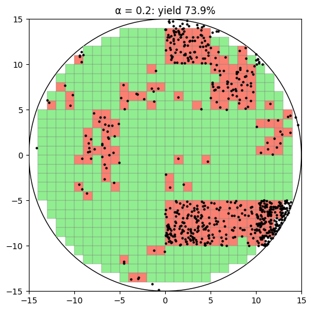

# Semiconductor Wafer Yield Simulator
Monte Carlo wafer yield simulator in Python. Models clustered defects, compares against Poisson and negative binomial yield formulas, and estimates cost per good die.

## What it does
- Simulates virtual wafers with randomly placed defects and counts working dies
- Models defect clustering with a Gamma-distributed contamination level (parameter alpha)
- Compares results against the Poisson and negative binomial yield formulas
- Calculates cost per good die
- Recovers the clustering parameter alpha from yield data alone
  
## Key results
- At D = 0.5 defects/cm², 1 cm² dies, alpha = 0.2: simulated yield 77.9%
  vs. 77.8% predicted by the negative binomial model (Poisson predicts 60.7%)
- Fitted alpha = 0.24 vs. true alpha = 0.2
- Cost per good die: $19.81 (clustered) vs. $25.44 (random defects), using an
  illustrative $10,000 wafer cost

## How to run
1. Open [Final_Wafer_Yield_Rate_Simulator.ipynb](Final_Wafer_Yield_Rate_Simulator.ipynb) in Google Colab (or Jupyter)
2. Run Cell 1 (engine), then Cell 2 (control panel) to change the inputs
3. Libraries used: numpy, matplotlib, scipy

## Full report
[Read the full report](Wafer-Yield-Simulator.pdf)

## Limitations
Validated against analytical models, not real fab data. Uniform defect
density across the wafer, and every defect is assumed to kill the die it lands on.
